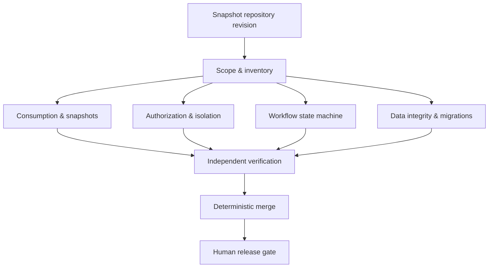

# Graph Audit v1 — Харчоблок

## Purpose
Read-only, evidence-driven release audit. This is a **design and execution contract**, not a claim that autonomous LLM agents are already running. The first implementation should run against a checked-out repository and produce machine-readable findings. No model may approve a clinical/nutrition calculation or mutate production data.

## DAG



## Worker contracts
Each worker receives `{repository, commit_sha, scope, paths, invariant_ids}` and returns JSON:
```json
{
  "status": "complete",
  "scope": "consumption",
  "commit_sha": "<SHA>",
  "inspected_files": [],
  "findings": [
    {
      "id": "CONS-001",
      "invariant": "INV-05",
      "severity": "high",
      "path": "apps/consumption/calc.py",
      "line": 1,
      "claim": "...",
      "evidence": "...",
      "reproduction": "...",
      "confidence": "unverified"
    }
  ],
  "errors": []
}
```
A worker must explicitly return `failed` if inspection was incomplete. Never treat missing output as zero findings. Output must validate against `docs/graph_audit.schema.json`.

### Scope mapping
- **Consumption**: `apps/consumption/`, `apps/catalog/`, `apps/planning/`; INV-01,02,04,05,06. Verify Decimal precision, gross vs net, and approved snapshot immutability. Compare against the manual control example in `docs/02_data_model.md`.
- **Authorization**: `apps/accounts/`, `apps/orders/`, relevant views; INV-07,08,09. Test unauthorized role, foreign department, and admin approval denial.
- **Workflow**: `apps/workflow/`, `apps/assist/`; INV-07,08,09. Check transition service, audit event, notifications, and AI draft-only restriction.
- **Data integrity**: model constraints, migrations, `apps/menus/`, `apps/planning/`; INV-01,02,03,05,06. Check uniqueness, FK constraints, historical snapshots and schema changes.

## Independent verifier
Use a fresh context with **only** the finding, relevant code, exact commit SHA, and independently obtained test output. Verify path/line exists, claim is reproducible, evidence supports severity, and invariant applies. Verdict: `confirmed | rejected | needs_human_review`. A second model opinion alone is not proof. Any ambiguous medical, nutrition or authorization finding must go to human review.

## Merge rules
Validate schema, require all four scope outputs, reject duplicate finding IDs, group duplicate root causes, preserve rejected findings separately, and never describe incomplete runs as passing. Release is blocked on failed scopes and confirmed critical findings; high findings require explicit human decision. Always report counts by scope and status.

## Operational limits
- First run: max four workers, one verifier per candidate, max 20 candidates, max one retry per failed worker.
- Run code from untrusted PRs with read-only permissions and without production secrets.
- Do not write to `main`, modify live data, call real Anthropic API in tests, or deploy.
- Budget/time limits must be set in the eventual orchestrator; do not claim zero-token cost.
- Run `pytest` and Django checks in an isolated environment; report actual exit codes. Tests not run are **unknown**, never green.

## Rollout
1. Inventory exact files and baseline tests.
2. Implement structured workers and schema validation.
3. Execute independent verifications using real tests or source-level reproductions.
4. Add CI only after a successful dry run; keep GitHub token `contents: read`.
5. Require human approval for PR merge and production deployment.
